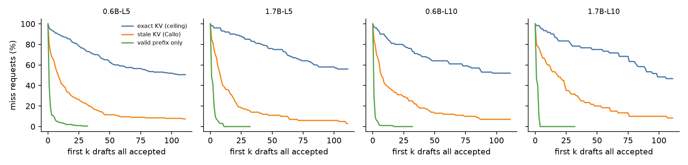
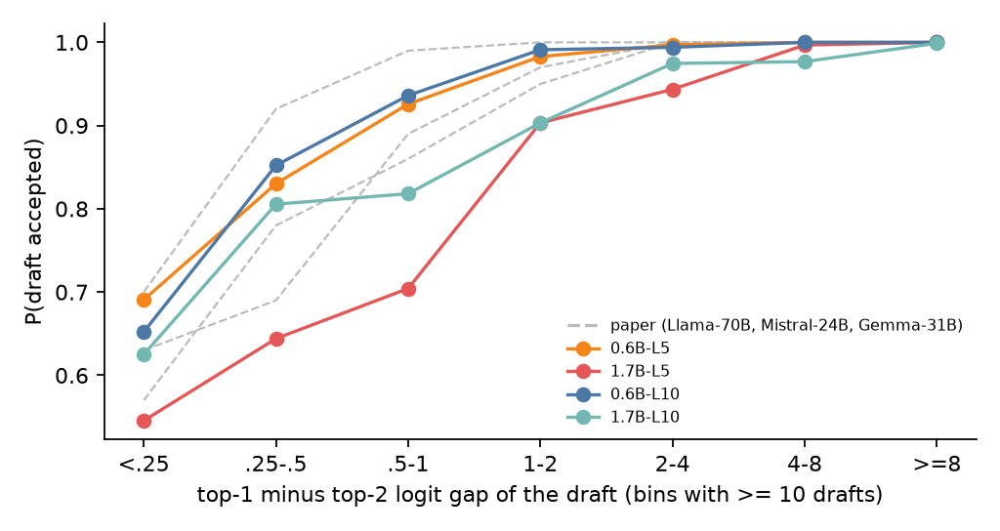
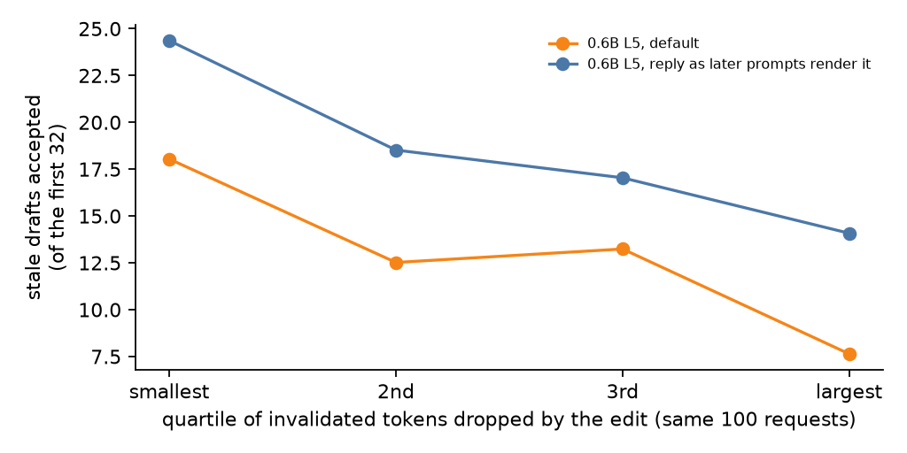
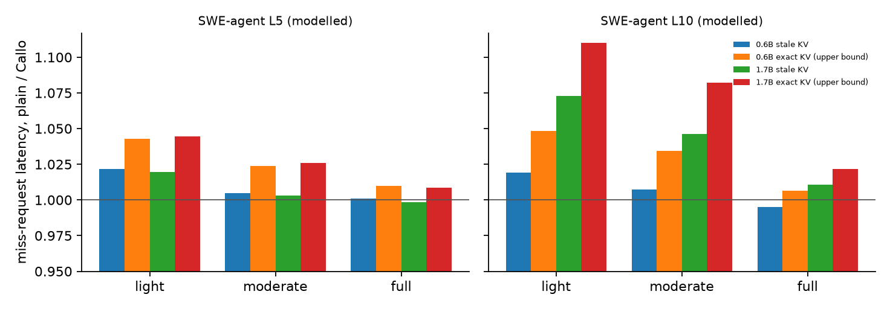

# stale-kv

**Your coding agent just masked an old tool output, and its KV cache no longer matches the prompt.
Draft the reply on the invalid cache anyway, then check it against the real one.** This repo is an open,
laptop-scale take on *Callo: Serving Cache-Miss Requests with Speculative Decoding on Invalidated KV under
Prefill-Decode Disaggregation* (Ou & Lentz, [arXiv 2611.18459](https://arxiv.org/abs/2611.18459), Nov 2026).
No official code had been released when this was written.

It replays real SWE-agent trajectories (one 3,229-trajectory shard of SWE-smith) under SWE-agent's own
observation masking. For each cache-miss request it builds Callo's provisional KV on Qwen3-0.6B and Qwen3-1.7B, drafts on it, and verifies every draft
against the exact KV. It also includes a small serving simulator, whose numbers are all modelled.

## The idea in one picture

```
previous request (its KV is on the decode GPU)
  [system][task][r1][obs1][r2][obs2] ... [r6][obs6][r7]            <- prompt + the reply it generated
next request: SWE-agent masks obs2 and appends obs7
  [system][task][r1][obs1][r2][ ph ] ... [r6][obs6][r7][obs7][gen]
  `----- exact prefix -----'`new-'`---- reused, stale ----'`- new -'

vLLM:  re-prefill everything after the edit on the prefill GPU, ship the KV, then decode.
Callo: on the decode GPU, copy the reused runs to their new positions (keys re-rotated by the shift),
       compute the few new tokens, and start drafting the reply on this stale cache while the exact
       prefill runs elsewhere. When the exact KV arrives, verify all drafts in one forward pass and
       keep the accepted prefix. Output is unchanged; only latency moves.
```

The reused span is *stale*: those tokens once attended to `obs2`, which is gone. The question is how
often a model drafting on it still writes what the exact KV would.

## Results

All requests are cache misses from SWE-agent's `LastNObservations` masking with N = 5 (L5) or N = 10
(L10), sampled in one seeded order with prompts capped at 8,192 tokens. Drafting is greedy, and the
window is 32 tokens as in the paper's offline study. "Whole window" means every draft in the window was
accepted, or the reply ended inside it and every draft up to the end was accepted.

| | Qwen3-0.6B L5 | Qwen3-1.7B L5 | Qwen3-0.6B L10 | Qwen3-1.7B L10 | paper, Llama-3.3-70B L5 |
|---|---|---|---|---|---|
| miss requests | 200 | 100 | 100 | 60 | 240 |
| **whole 32-token window accepted, stale KV (Callo)** | **21.5%** | **15.0%** | **25.0%** | **31.7%** | **65%** (70% any-max) |
| whole window, exact KV (the ceiling) | 73.0% | 85.0% | 73.0% | 78.3% | 80% (86%) |
| whole window, stale KV without re-rotation | 9.0% | 6.0% | 7.0% | 6.7% | |
| whole window, valid prefix only | 0.5% | 0% | 0% | 0% | 10% |
| whole window, prompt-lookup n-grams | 0% | 0% | 0% | 0% | 12% |
| mean drafts accepted of 32, stale / exact KV | 12.4 / 26.9 | 11.5 / 28.9 | 12.6 / 26.3 | 16.6 / 28.0 | |
| mean drafts accepted of 111, stale / exact KV | 17.8 / 61.8 | 17.2 / 77.8 | 18.0 / 57.0 | 25.8 / 74.8 | 22.6 online (fixed-tie) |
| teacher-forced next-token agreement | 94.5% | 94.0% | 94.7% | 95.4% | 98.3% |
| positions within 0.01 total variation | 40% | 63% | 40% | 65% | 80% |
| agreement where the logit gap is >= 1 | 99.5% | 98.2% | 99.6% | 98.4% | 97–100% |
| agreement where the logit gap is < 0.5 | 75.6% | 59.6% | 73.6% | 72.1% | 65% |
| near ties (gap < 0.5): share of positions | 15.2% | 6.3% | 14.6% | 4.2% | 2.4% |
| near ties: share of first mismatches | 75% | 47% | 79% | 35% | 60% |

Fixed-tie and any-max verification agree everywhere here, because logits are kept in float32 (see
[Numerics](#numerics)).

**What reproduced.**

- **The workload.** Replaying SWE-smith's SWE-agent trajectories under L5 masking gives a miss rate of
  80.9%, a median re-prefill per miss of 2.9k tokens (p90 7.2k) and a median reusable span of 2.4k
  (p90 6.4k). The paper's Llama L5 replay has 79%, 3.1k (8.9k) and 2.5k (7.4k). At L10 the numbers are 65%,
  6.2k (11.8k) and 5.7k (11.1k), against the paper's 58%, 8.3k (18.3k) and 7.6k (16.8k).
- **Where the model is sure, stale KV is right.** When the draft's top-1 logit leads by at least 1, the
  stale cache gives the exact model's token 98–99.6% of the time (paper: 97–100%). Both Qwen3-0.6B
  acceptance-by-gap curves fall inside the band of the paper's three models; the 1.7B curves sit below it
  between gaps of 0.25 and 4 ([figure](#agreement-by-logit-gap)).
- **Near ties cause many of the failures.** 75–79% (0.6B) and 35–47% (1.7B) of first mismatches happen
  where the top-2 logits are within 0.5 of each other; the paper reports 60%.
- **The exact-KV ceiling.** Drafting on the *exact* KV and verifying in one chunk keeps the whole window
  73–85% of the time, against the paper's 80%. Those misses are numerical, and most sit at near ties:
  92% (0.6B) and 57% (1.7B) of them are at logit gaps below 0.1.
- **The baselines lose by a mile.** Prompt-lookup n-grams and drafting on the valid prefix alone accept
  0.4–0.7 and 0.6–1.5 tokens on average, against 11.5–16.6 for stale KV.

**What did not reproduce.** At this scale the whole window survives for 15–32% of miss requests,
against 65–70% for Llama-3.3-70B. Per-position agreement is 94–95% rather than 98.3%, and a 32-token
window compounds that gap: 0.945³² is about 16%. Two things explain most of it.

- **The chat template.** Qwen3 writes an empty `<think>` block in front of every reply it generates,
  then leaves it out when the reply reappears in history. So the last reply's KV is stale even before any
  masking. Putting the reply in the invalidated state the way later prompts render it lifts 0.6B L5 from
  19% to 36% whole windows, and per-position agreement from 94.5% to 97.2%
  ([Ablations](#ablations)).
- **Model size.** The two small models fail differently. The 0.6B model sits in a near tie at 15% of
  positions, six times the paper's rate. The 1.7B model has fewer near ties (4–6%), but it disagrees more
  where it is confident: 90% agreement in the 1–2 gap bin, against 98% for the 0.6B model.

L10 misses do a little better than L5 (25% and 32%) even though they reuse about twice as much stale KV;
their edit sits ten observations back instead of five. The 1.7B L10 column has only 60 requests. Whether
acceptance reaches the paper's level somewhere between 2B and 24B is not something this repo can show.

### Accepted drafts



Share of miss requests whose first k drafts were all accepted, with drafting capped at 111 tokens (the
paper's online cap). Stale KV gets 46% as many accepted drafts as exact KV in the first 32 positions and
29% over 111. Drafting on the valid prefix alone collapses within a few tokens, because the model has lost
the last four observations.

### Agreement by logit gap



P(draft accepted | every earlier draft accepted), binned by the draft's top-1 minus top-2 logit gap, as in
the paper's Table 6. Grey dashed lines are the paper's three models.

### Re-rotation matters

Copying the stale keys to their new positions *without* re-rotating them (the RoPE angle stays at the old
position) cuts mean accepted drafts at L5 from 12.4 to 5.2 (0.6B) and from 11.5 to 3.6 (1.7B). The
shifts involved are small (the median masked observation is a few hundred tokens), so this is not
obvious in advance.

### Does a bigger edit make the cache staler? Only for the 0.6B model



Mean stale drafts accepted (of 32) by quartile of how many invalidated tokens the edit dropped, for the
same 100 0.6B L5 requests with and without the template fix from [Reply rendering](#reply-rendering).
For Qwen3-0.6B at L5, larger removed observations cost more drafts: Spearman ρ = −0.20 (p = 0.004) with
the default rendering, and −0.33 (p = 0.001) once the template mismatch is gone. The other runs show no
such relation: ρ = 0.05 for 1.7B L5, 0.06 for 0.6B L10 and 0.02 for 1.7B L10, all with p > 0.5. How
much stale context is reused shows no relation in any run (|ρ| < 0.09). Read this as a 0.6B effect, not a
general law.

### Early stopping

Callo stops drafting once the product of per-draft agreement estimates (looked up by logit gap) falls
below θ = 0.3. Fitting that table on one session in five and applying it to the rest:

| | 0.6B L5 | 1.7B L5 |
|---|---|---|
| drafts made, share of no-stop | 32% | 29% |
| accepted drafts kept | 70% | 74% |
| drafts wasted (rejected or after a rejection), no stop → with stop | 78% → 52% | 83% → 57% |

### Ablations

Both ablations use Qwen3-0.6B at L5 and are compared with the default run on the same requests.

| | requests | whole window, stale / exact KV | mean accepted of 32, stale / exact KV |
|---|---|---|---|
| default (on the same requests) | 100 | 19% / 74% | 12.9 / 27.2 |
| **reply KV as later prompts render it** | 100 | **36%** / 74% | **18.5** / 27.2 |
| default (on the same requests) | 60 | 18% / 77% | 13.0 / 27.0 |
| logits rounded to bf16, fixed-tie verification | 60 | 20% / 65% | 12.9 / 25.1 |
| logits rounded to bf16, any-max verification | 60 | 30% / 83% | |

With the reply rendered as later prompts render it, teacher-forced agreement rises from 94.5% to 97.2%
(the paper: 98.3%), and mean accepted drafts at the 111-token cap go from 17.8 to 29.7.

<a id="numerics"></a>**Numerics.** In bf16, logits near 20 are 0.125 apart. Two numerically different forward
passes (one token at a time, then one verification chunk) therefore often land on exact ties or one-step
flips. By default the LM head here writes float32 output (bf16 matmul, float32 result), so exact ties
vanish and fixed-tie and any-max verification agree. Rounding logits to bf16 lowers the exact-KV ceiling
from 77% to 65% and leaves stale-KV acceptance where it was. Any-max verification then accepts the tied
drafts and lifts both rates (30% and 83%). The paper's numbers have the same shape: any-max adds 5–6
points to both. That suggests its engine had bf16-style ties too.

<a id="reply-rendering"></a>**Reply rendering.** The decode instance generated the previous reply after
`<think>\n\n</think>\n\n`, and later prompts render that reply without it. The default runs keep this
mismatch, because it is what a Qwen3 deployment would actually hold. The counterfactual row instead puts
the reply in the invalidated state as later prompts render it, so the only staleness left is the masked
observation. Four missing template tokens in front of the last reply cost almost half the stale drafts:
removing them takes the whole-window rate from 19% to 36% and mean accepted drafts from 12.9 to 18.5.
The paper's Gemma check found a similar jump, from 17.2 to 23.0 accepted drafts. The practical point is
for anyone serving agents with Qwen3's default template: a history that renders replies exactly as they
were generated helps Callo, and it helps the ordinary prefix cache too.

## Serving model (modelled, not measured)

`stale_kv/sim.py` is a discrete-event model of one prefill and one decode instance. It replays 100
held-out trajectories (3,140 requests at L5) as closed-loop sessions with a 2 s tool time. Step times
come from the paper's own fit to Llama-3.3-70B FP8 on an H200 pair (Eq. 2, App. F.2), with a batch limit
of 16. Drafting outcomes are replayed from the acceptance records above, using the paper's rules:
admission on arrival, at least 256 reusable tokens, staged tokens × current batch ≤ 4,096, 112-token staging
chunks, a 111-draft cap, early stop at θ = 0.3, and yielding to ready requests. Capacity is the highest
session rate at which plain serving's mean latency stays under 3× its light-load value. Loads are 12%,
52% and 100% of that capacity, the paper's light, moderate and full.



Mean miss-request latency, plain / Callo:

| | light | moderate | full |
|---|---|---|---|
| **L5**, Qwen3-0.6B stale-KV acceptance | 1.022× | 1.005× | 1.001× |
| L5, Qwen3-1.7B stale-KV acceptance | 1.020× | 1.003× | 0.998× |
| L5, exact-KV acceptance (upper bound) | 1.04× | 1.02–1.03× | 1.01× |
| L5, paper, measured on 2× H200 (Llama-3.3-70B) | 1.13× | 1.19× | 1.32× |
| **L10**, Qwen3-0.6B stale-KV acceptance | 1.019× | 1.007× | 0.995× |
| L10, Qwen3-1.7B stale-KV acceptance | 1.073× | 1.046× | 1.011× |
| L10, exact-KV acceptance (upper bound) | 1.05–1.11× | 1.03–1.08× | 1.01–1.02× |
| L10, paper, measured | 1.24× | 1.24× | 1.21× |

Read this table as an accounting, not a forecast. At L5 with Qwen3-sized acceptance, Callo saves about
0.12 s per miss at light load. Near capacity it saves almost nothing, because speculation competes with
ready requests for batch slots. Re-prefills at L10 are twice as long (median 6.2k tokens), which leaves
more time to draft, and the 1.7B model's L10 acceptance saves 0.47 s. Even with exact-KV acceptance this
model saves 0.24 s at L5 and 0.3–0.7 s at L10.

The paper measures 0.8 s at L5 and splits it into two halves. In one, the exact KV arrives 0.4 s sooner
than under vLLM. This simulator's baseline never waits on the decode side before the KV transfer, so that
half cannot show up here. In the other half, decoding after arrival falls by 0.4 s. That half is what this
model captures, and with exact-KV acceptance it gets 0.24 s of it at L5.

## How it works

| step | where | what |
|---|---|---|
| replay | `stale_kv/sessions.py` | SWE-agent 1.x trajectories (system, task, then assistant/observation turns). Request t masks observation i once i ≤ t − 1 − N, with SWE-agent's placeholder `Old environment output: (n lines omitted)`. The invalidated state is the previous prompt plus the reply it generated. |
| align | `stale_kv/align.py` | Common prefix (exact), then greedy in-order runs of ≥ 16 identical tokens found with a hashed 16-gram index and extended both ways. The rest of the new prompt is new. |
| provisional KV | `stale_kv/kv.py` `make_provisional` | Move each run in place, one layer at a time. Keys are rotated by Δ = p′ − p in float32; values are copied as they are. Then compute the new spans left to right in 112-token chunks over the assembled cache. |
| draft | `kv.py` `decode_greedy` | Greedy, one token per step, as a CUDA graph over a preallocated cache (the eager Python path costs about 150 ms per token on this laptop; the graph costs 27–50 ms with the GPU shared). Ties go to the lowest token id. Each step's top-1/top-2 logit gap is recorded. |
| verify | `kv.py` `score_chunk` | One forward pass over `[last prompt token] + drafts` on the exact KV. Fixed-tie: draft == row argmax. Any-max: draft logit == row max. |
| teacher forcing | `measure.py` | Feed the exact reply on the provisional KV and compare per-position argmax and total variation. |

The engine reuses the model's own modules (embeddings, RMSNorms, projections, rotary embedding, MLP) and
owns only the KV layout. A test checks its logits and KV against Hugging Face's forward pass. Another
checks that re-rotation reproduces a recomputed shift at every layer. A third checks that a provisional
cache with nothing stale equals an exact prefill.

### Setup and how it differs from the paper

- **Trajectories:** one shard of [SWE-smith trajectories](https://huggingface.co/datasets/SWE-bench/SWE-smith-trajectories)
  (`ticks` split, shard 1 of 8, 95 MB, MIT). These are SWE-agent 1.x runs by Claude 3.7 Sonnet. The
  replies in the history were written by Claude; Qwen3 writes only the reply under test. The paper
  recorded each model's own SWE-agent sessions on SWE-bench Verified.
- **Models:** Qwen3-0.6B and Qwen3-1.7B in bf16, non-thinking mode, on one RTX 5060 Laptop GPU (8 GB).
  The paper used Llama-3.3-70B FP8, Gemma-4-31B and Mistral-Small-3.2-24B on H200s.
- **Context cap:** prompts of at most 8,192 tokens, which is 74% of L5 misses and 47% of L10 misses.
  Sampling is therefore tilted toward earlier, shorter parts of sessions.
- **Alignment:** the paper does not give a minimum run length; this repo uses 16.
- **"Valid prefix only":** our reading of the paper's "target model with only the valid prefix" baseline.
  It is the exact prefix plus the staged spans, with the reused middle dropped.
- **Prompt lookup:** Qwen3's generation prompt ends in an empty think block, so the lookup context drops
  it. Lookup then continues from the reply header, which is what an n-gram drafter sees under templates
  without that block.

## What was not done

- No models above 1.7B: they would not fit next to two 8k-token caches in 8 GB, and larger downloads were
  out of scope. The 65–70% whole-window result for 24–70B models is the paper's, not checked here.
- No real disaggregated serving. There is no vLLM, no second GPU and no KV transfer, so every latency
  number is modelled.
- No sampling-based verification (the paper also runs speculative sampling at T = 0.8). Greedy only.
- The simulator leaves out link sharing, prefill batching across requests, the remote-KV handshake that
  gives the paper half its gain, and preemption.
- No cost model fitted to this laptop. `experiments/bench_engine.py` tried one. Each eager forward costs
  about 90 ms of Python and kernel-launch overhead whatever its size, and graph-replayed decode steps took
  27–50 ms with other jobs on the GPU. The fitted slopes came out negative, so the simulator uses the
  paper's H200 fit instead. The raw bench is in `results/sim/bench-Qwen3-0.6B.json`.

## Reproduce

```bash
pip install -e ".[data,figures,test]"
mkdir -p data/raw && curl -L -o data/raw/ticks-00001-of-00008.parquet \
  https://huggingface.co/datasets/SWE-bench/SWE-smith-trajectories/resolve/main/data/ticks-00001-of-00008.parquet
bash experiments/run_all.sh            # acceptance runs (CUDA GPU; about 3 h on a shared laptop GPU)
python experiments/summarize.py        # tables + docs/figures
python experiments/run_sim.py --keep-last 5 --records Qwen3-0.6B-L5 Qwen3-1.7B-L5
python experiments/run_sim.py --keep-last 10 --records Qwen3-0.6B-L10 Qwen3-1.7B-L10
pytest -q                              # 56 tests, CPU only, no weights or data needed
```

Raw per-request records, including drafts, gaps, acceptance and timings, are in `results/acceptance/`.
The summary is in `results/summary.json`, and simulator outputs and workloads are in `results/sim/`.

## License

MIT. The trajectory data is not redistributed here; it is MIT-licensed by SWE-smith.

```bibtex
@article{ou2026callo,
  title  = {Callo: Serving Cache-Miss Requests with Speculative Decoding on Invalidated KV under Prefill-Decode Disaggregation},
  author = {Ou, Jianjun and Lentz, Matthew},
  journal= {arXiv preprint arXiv:2611.18459},
  year   = {2026}
}
```
